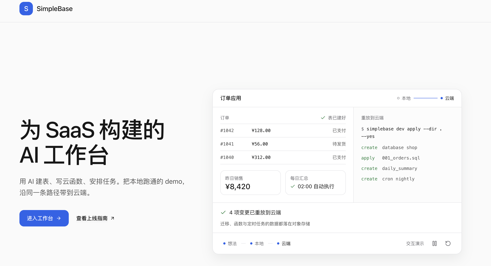
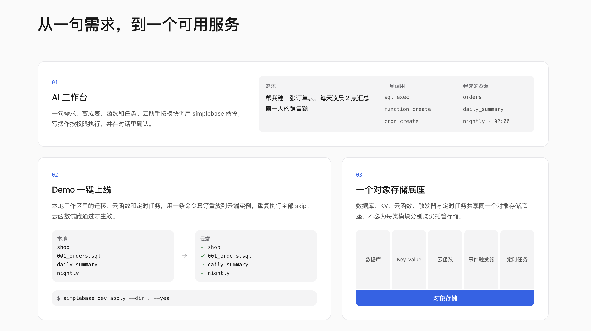
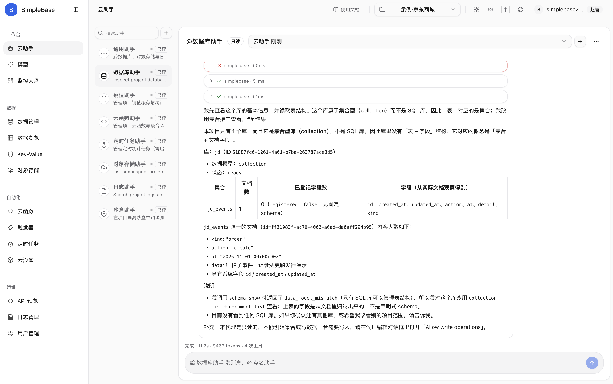

# 开源项目|让你的Demo直接上线的AI平台-SimpleBase

用 AI+ 人工打磨了半个多月，终于将 SimpleBase 开源了。

项目地址：<https://github.com/linkxzhou/SimpleBase>



## SimpleBase 是什么？

做 Demo 最痛的往往不是业务逻辑，而是后端那一堆东西：数据库、缓存、文件存储、定时任务、大模型接入，以及把本地跑通的东西搬上云。

SimpleBase 的思路是：**一个二进制，起一套后端**。数据库（SQL / 集合 / KV）、对象存储、Go 云函数、定时任务、触发器、实时订阅、备份、LLM 网关和云助手都在同一个服务里，自带 Vue 控制台与 CLI。本地用本地盘，生产切到 S3，业务代码只换 URL 和 Key。

- **零依赖起步**：不需要 Postgres / Redis / S3，前端经 `go:embed` 打进二进制。
- **每项目一个单文件库**：DuckDB 或 SQLite，SQL、集合、KV 共用；S3 模式下快照加 manifest 同步，丢盘可恢复。
- **安全默认值**：API Key 哈希存储、权限与 Scoped Key、系统库只读、SQL 守卫、日志脱敏。

## SimpleBase 支持哪些功能？



| 模块 | 能力 |
| --- | --- |
| 工作台 | 云助手（按模块分工，写操作需确认，只读助手拿不到写权限）、监控大盘、OpenAI 兼容的 LLM 网关 |
| 数据 | SQL（参数化、批量事务）、JSON 集合、KV（String / Hash / List / Set / ZSet / TTL）、S3 对象存储、SSE 实时订阅 |
| 自动化 | Go 云函数（单文件 `package main`，免构建，试跑通过才上线）、cron / interval / once 定时任务、事件触发器、云沙盒 |
| 运维 | 日志、审计、配额、用户管理、项目级备份与恢复 |



最喜欢的一个功能是**本地开发，云端幂等重放**：把库、迁移、云函数、定时任务声明在 `simplebase.json` 里，`simplebase dev plan` 先看计划，`apply` 先查后写、重复执行全部 skip，迁移只追加，远端执行必须带 `--yes`。

## SimpleBase 如何使用？

准备 Go 1.25+、Node.js 22.22.2+、Yarn 4.17 和支持 CGO 的 C 编译器，然后：

```bash
git clone https://github.com/linkxzhou/SimpleBase.git
cd SimpleBase
./build.sh dev --no-open      # 后端 :8080，控制台 :5173
```

用引导账号 `simplebase2026` / `simplebase2026` 登录（首次必须改密），创建项目，在「设置 → 连接」签发 API Key，然后跑第一条 SQL：

```bash
curl -sS -X POST "$BASE/v1/projects/$PROJECT/databases/$DATABASE/query" \
  -H "Authorization: Bearer $SB_KEY" -H 'Content-Type: application/json' \
  -d '{"sql":"SELECT 1 + 1 AS answer","max_rows":10}'
```

Demo 跑通后，带到云端：

```bash
simplebase dev plan  --dir .                       # 只读列出 create/update/apply/skip
simplebase dev apply --dir . --seed                # 本地执行
SIMPLEBASE_URL=https://cloud.example.com SIMPLEBASE_API_KEY=<云端 Key> \
simplebase dev apply --dir . --yes                 # 云端重放
```

仓库 `examples/` 里有 4 个业务站点和 15 个能力用例，可以先看看。
