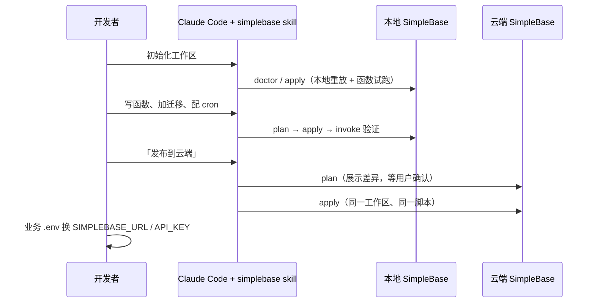

# SimpleBase 云端协同：本地开发、云端重放（planv6.4）

> **状态：** P0a、P0b 均已实现（`skills/simplebase` + `simplebase dev validate|plan|apply|status`）；§8 为 P0 复盘与剩余问题；P1 起为后续计划  
> **日期：** 2026-11-05（初稿 2026-11-03，修订 2026-11-04）  
> **关联：** `examples/*/simplebase.json` + `examples/lib/init/run.mjs`（现有清单驱动初始化器）、`internal/sbcli`、`docs/cli.md`、`docs/sdk/quickstart.md`、`gocloudagent/skills/simplebase/`（云助手 skill，不改）

**Goal：** 产品形态是「`simplebase` 二进制 + Claude Code Skill」。业务在本地用 Skill 开发和验证，开发产物（迁移、云函数、定时任务、集合声明）放在可版本化的工作区里，用同一套 CLI 幂等重放到云端。业务代码只改环境变量，不改代码路径。

**Architecture：** 工作区本身就是 artifact（git 管理），不另造打包格式。重放器是一个只调 `simplebase` CLI 的编排脚本：先读远端状态，算出差异（plan），再按固定顺序执行（apply）。每一步都是「先查再写」，所以中断后从头重跑即可续上。

---

## 0. 评审结论（相对初稿的修订）

初稿方向正确：CLI 作唯一操作面、密钥不进 artifact、默认不搬数据、与云助手 skill 分离。但对照代码后，有几处与现状冲突或明显过度设计：

| # | 初稿内容 | 问题（代码事实） | 修订 |
| --- | --- | --- | --- |
| 1 | 新建 `simplebase.yaml` manifest | 仓库已有 `simplebase.json` 清单与 `examples/lib/init/run.mjs` 重放实现（库、迁移、函数 sha 比对、cron upsert），初稿未提及，会出现两套清单 | **沿用 `simplebase.json`**，取其可移植子集；`examples/` 后续迁到同一重放器 |
| 2 | 迁移表 `_sb_schema_migrations` | 示例已用 `_migrations(name, applied_at)`；另起一张表，老库会重复执行迁移 | 沿用 `_migrations`；checksum 放 lock，不改表结构 |
| 3 | `databases[].engine: duckdb` | 引擎是**项目级**（`project create --engine`、`database.engine` 配置），库只有 `data_model`（`sql`/`collection`，**缺省是 collection**，`--init-sql` 只对 sql 库有效） | manifest 改为 `data_model`；有 `migrations` 时缺省 `sql` |
| 4 | 单个 `simplebase.lock.json` 记录「名称→云端 ID」 | 库 ID 在本地、云端各不相同，单 lock 会互相覆盖 | lock 按 `endpoint#project` 分区：`.simplebase/lock.json` |
| 5 | 「只换域名」 | 库 ID 跨实例不同；SDK 读 `SIMPLEBASE_API_KEY`，CLI 读 `SIMPLEBASE_TOKEN`，变量名不一致 | 契约改为「换 URL + Key」：两端**用同一个 project ID**（8 位，可指定），库 ID 由 apply 输出到 `.simplebase/env.<label>`，或业务启动时按库名解析；重放器把 `SIMPLEBASE_API_KEY` 映射为 CLI 的 token；P0b 让 CLI 原生兼容 `SIMPLEBASE_API_KEY` |
| 6 | 函数「更新」路径待调研（§11） | 已有：`function versions create`（默认不生效）+ `function test --version` + `function activate`；`function get` 返回生效源码 | 风险关闭。按 sha256 比对源码，相同则跳过（每函数只有 50 个版本，不能每次 push 都建版本） |
| 7 | `.sbpack` 打包 + `push --from-step` 游标续跑 | 每步都先查再写时，重跑就是续跑；游标与打包格式增加状态，没有带来新能力 | 删除 `--from-step`；`package` 降级为 `plan`（只读差异）。tarball 留到 P2 有离线交付需求时再做 |
| 8 | 版本对齐用 `serverVersion` | 服务端没有版本接口（`/health/live`、`/health/ready` 只返回状态码） | P0 只记录 CLI 版本；版本接口放 P1 |
| 9 | 迁移约束未提 | DuckLake 不支持 `PRIMARY KEY`/`UNIQUE`/`CREATE INDEX`/`CREATE SEQUENCE`（`run.mjs` 的 `checkDDL`）；sqlguard 保留 `__sb_`/`__ducklake_metadata_`/`sqlite_` 前缀；单个 batch 上限 100 条（`limits.max_batch_statements`）；不允许 `ATTACH/COPY/SET/PRAGMA/CALL` | 写进 validate 和 skill |
| 10 | push 使用「项目 API Key」 | `POST /databases` 需要 `database:admin`，函数与 cron 写入需要 `database:write` | 发布 Key 需要 `database:admin`；运行时 Key 只给 `database:read`/`database:write` |
| 11 | `seeds/policy.yaml` 策略文件 | P0 只需要一个开关 | 种子只在显式 `--seed` 时执行，按 `seed:<file>` 记账；policy 文件放 P2 |
| 12 | 文件名与标题版本不一致（目录 planv6.4、标题 planv7.0） | 代码注释按 `planX §Y` 引用，需唯一 | 统一为 planv6.4 |

开放问题的倾向答案：

1. **P0 云端目标**：任意一套同版本 SimpleBase（含轻服务实例）；重放器只要求 URL + Key + project。
2. **Skill 目录**：只发 Claude Code 的 `skills/simplebase/`；Cursor 等工具读同一份 `SKILL.md`，不复制。
3. **前端直连**：不支持。Key 不进前端，沿用 examples 的 BFF 模式；「只换 URL」只对服务端 SDK 承诺。

---

## 1. Global Constraints

- 密钥只放环境变量、工作区 `.env`（gitignore）或 `$XDG_CONFIG_HOME/simplebase/config.json`（0600）。不进 manifest、lock、日志和对话。
- 重放必须幂等：同一工作区连续 apply 两次，第二次全部 `skip`，退出码 0。
- 默认只同步结构和代码，不同步数据；种子需要显式 `--seed`。
- 只调用现有 CLI（`database`/`sql`/`collection`/`document`/`function`/`cron`），不增加第二套部署 API。
- 单写实例约束不变；破坏性操作（删库、删函数、删任务、`cron trigger`）不进入自动重放。

## 2. 用户旅程



## 3. 工作区与清单

```text
my-app/
  simplebase.json        # 清单（非密钥）
  .env                   # gitignore：SIMPLEBASE_URL / SIMPLEBASE_API_KEY / SIMPLEBASE_PROJECT_ID
  .env.cloud             # gitignore：云端同名变量
  migrations/001_init.sql
  functions/hello.go
  seed/dev.sql           # 可选，仅 --seed
  .simplebase/lock.json  # 各环境 ID 映射 + 迁移 checksum（无密钥，可提交）
  .simplebase/env.local  # apply 生成：URL、PROJECT_ID、DATABASE_ID_<NAME>（无密钥）
```

`simplebase.json` 是现有示例格式的子集：

```json
{
  "project": { "id": "myapp001", "name": "My App" },
  "databases": [
    { "name": "main", "data_model": "sql", "migrations": "migrations", "seed": "seed/dev.sql" },
    { "name": "docs", "data_model": "collection" }
  ],
  "collections": [{ "database": "docs", "name": "posts", "seed": [{ "id": "demo", "title": "hi" }] }],
  "functions": [{ "name": "hello", "file": "functions/hello.go", "description": "示例",
                  "test": { "function_name": "Hello", "body": { "name": "sb" } } }],
  "cron_jobs": [{ "name": "daily", "schedule_kind": "cron", "cron_expr": "0 3 * * *",
                  "func_file": "hello", "func_export": "Hello", "input_json": "{}", "enabled": true }]
}
```

示例中的 `kv`、`objects`、`api_keys`、`agents`、`trigger_once` 不进入重放器：`api_keys` 会产出密钥；`trigger_once` 有副作用；kv/objects 属于数据，放 P1 的 `--seed` 扩展。遇到这些字段时打印警告并忽略。

## 4. 重放语义

固定顺序：校验 → 库 → 迁移 → (种子) → 集合 → 函数 → 定时任务。每步都是查询后再决定写入，输出 `create`/`update`/`skip` 动作。

| 资源 | 判定 | 写入 |
| --- | --- | --- |
| 数据库 | 优先用 lock 里的 ID（`database get` 校验），否则按名称在 `database list` 中查找 | `database create --name --data-model`，ID 写回 lock |
| 迁移（sql 库） | `CREATE TABLE IF NOT EXISTS _migrations(name VARCHAR, applied_at VARCHAR)`；`SELECT name FROM _migrations` | 每个未应用文件一个 `sql batch --transactional`，末尾插入记账行；已应用文件的 sha 与 lock 不一致时报 `migration_modified` 并停止 |
| 种子 | 仅 `--seed`；记账名 `seed:<file>` | 同迁移 |
| 集合 | `collection list` | `collection create`；文档种子仅 `--seed`，按 `id` 去重 |
| 云函数 | `function get`；比对生效版本与最新版本源码的 sha256 | 新函数用 `function create`；源码变化时 `versions create` → `function test`（配置了 test 时）→ `activate`；最新版本源码相同则复用，不新建版本 |
| 定时任务 | `cron list` 按 name 匹配，比较调度、目标、input、enabled、description | `cron create`，或带全量字段 `cron update --id`；`once` 的 `run_at` 已过期时跳过并警告 |

失败策略：任一步失败时立即停止，打印出错步骤和 `error.code`，退出码 2。已经完成的步骤在下次运行时自然变为 `skip`。

不做：删除远端多余资源（只报告 `extra`）、自动回滚、双向合并。

## 5. 交付拆分

### P0a — Skill + 编排脚本（已完成，无服务端改动）

- `skills/simplebase/SKILL.md`：工作流、边界、确认点。
- `skills/simplebase/references/`：清单格式、gofunction 约束、SQL/迁移约束、CLI 速查与错误码。
- `skills/simplebase/scripts/sbdev.py`：只用 Python 3 标准库，子命令 `init`/`doctor`/`validate`/`plan`/`apply`/`status`，通过子进程调用 `simplebase` CLI，token 经环境变量传入（不出现在 argv 和 `ps` 中）。

**验收：**

1. 空目录执行 `init` → 本地 `apply` → `function invoke` 成功。
2. 新增 `002_*.sql` 后再 apply，只执行 002。
3. 连续 apply 两次，第二次全部为 skip，退出码 0。
4. 修改已应用的迁移文件后 apply，报 `migration_modified`。
5. 函数源码不变时不新增版本。
6. 云端（同 project ID）apply 后，业务只改 `SIMPLEBASE_URL`/`SIMPLEBASE_API_KEY` 即可调用同名函数。
7. 函数源码里出现疑似密钥时，validate 失败。

### P0b — 产品化进 CLI（已实现）

落地情况与实现取舍：

- `internal/sbcli/dev.go`（重放器）、`dev_workspace.go`（清单读取与离线校验）、`dev_test.go`；`dev validate|plan|apply|status` 登记在 `dispatch`，除 `dev apply` 外都进只读表；助手模式一律 `file_not_allowed`。`dev validate` / `dev status` 不访问远端，因此不要求连接配置。
- 退出码 3（需要 `--yes`）经 `devError` 由 `RunIO` 识别，计划写 stdout、错误信封写 stderr。
- 对账：`internal/sbcli/testdata/dev/{basic,invalid}` 同时被 Go 测试和 `skills/simplebase/scripts/test_sbdev.py` 读取，校验结论与 plan 动作序列一致；P0a 用假 `simplebase` 脚本覆盖 7 条验收。
- 相对初稿的修正：新函数改为 `function create --activate false` → 试跑 → `activate`（SDK 新增 `CreateFunctionWith`，旧签名不变）；`function get` 找不到函数返回 `not_found`；缺省 `data_model` 在「有迁移且没有集合引用」时才推断为 `sql`，否则 `collection`（examples 的 community / ops-assistant 在 collection 库上跑迁移）；plan 阶段用查询 `_migrations` 失败判断「未建表」，不依赖只对 sql 库可用的 `schema show`。
- 新增 `--manifest <文件>`：examples 初始化脚本传入派生清单（补 once 的 `run_at`、固定 `data_model`），不改仓库里的清单。
- `examples/lib/init/run.mjs` 改为调用 `simplebase dev apply --seed --yes`；项目创建、Key 签发与 `trigger_once` 仍由脚本处理（需要超管或有副作用）。
- CLI 兼容 `SIMPLEBASE_API_KEY`（`SIMPLEBASE_TOKEN` 优先，空值视为未设置）。
- 文档：`docs/getting-started/local-cloud-collab.md`。
- 测试：sbcli 单测用 httptest fake server，`TestDevRemoteRequiresYesAndTwoTargets` 用两个端口模拟 local/cloud。

验收与测试对应（两端各一套，同一组 fixture）：

| 验收 | `test_sbdev.py` | `dev_test.go` |
| --- | --- | --- |
| 1 init → apply → invoke | `test_init_apply_then_invoke` | `TestDevApplyIdempotentLocal`（不含 invoke） |
| 2 只执行新迁移 | `test_new_migration_runs_only_new_file` | `TestDevApplyIdempotentLocal` |
| 3 二次 apply 全 skip | `test_second_apply_is_all_skip` | `TestDevApplyIdempotentLocal` |
| 4 `migration_modified` | `test_modified_migration_is_rejected` | `TestDevModifiedMigrationRejected` |
| 5 源码不变不建版本 | `test_function_versions` | `TestDevFunctionVersioning` |
| 6 云端同 project 重放 | `test_remote_requires_yes` | `TestDevRemoteRequiresYesAndTwoTargets` |
| 7 疑似密钥 | `test_secret_in_function_fails_validate` | `TestDevFixtureValidation`（invalid） |

### P1

- 服务端版本接口（`/health/live` 附 `version`），apply 时 major 不一致默认拒绝。
- 漂移检测：`plan` 报告远端多出的函数/任务/表（`schema show` 对比迁移推导结果）。
- `pull`：把已有云端项目的函数源码与 cron 声明导出为工作区。
- kv/objects 种子；CI 示例（GitHub Action：validate + plan + apply）。

### P2

- 多环境 profile、种子审批、离线 tarball、控制台「从工作区导入」。

## 6. 安全

| 项 | 要求 |
| --- | --- |
| 凭据 | 只从环境变量或 `--env-file` 读取，传给子进程环境，不打印；脚本输出经 CLI 自带的脱敏 |
| 扫描 | validate 对 manifest 引用的文件扫描私钥头、`sk-`、`AKID`、`AKIA` 等密钥形态；manifest 不得引用 `.env*` |
| Key 权限 | 发布 Key 需要 `database:admin`；业务运行时 Key 只给读写权限，不复用发布 Key |
| 云助手 | 不变：云助手 skill 不加载工作区能力，不做发布 |
| 审计 | 复用现有审计（函数保存/试跑已有记录）；P1 再考虑 apply 汇总审计 |

## 7. 风险

| 风险 | 倾向 |
| --- | --- |
| `;` 拆分 SQL 遇到字符串里的分号 | 已关闭（§8）：两端改为跳过 `'…'`、`"…"`、`$$…$$` 与 `--` / `/* */` 注释里的分号，并用脱敏副本做关键字检查 |
| 迁移部分成功 | 每个文件一个事务 batch；DuckDB DDL 支持事务，失败时整文件回滚 |
| 库名重复或被改名 | lock 优先；按名称命中多个库时报错，让用户在 lock 中指定 |
| 函数版本耗尽（50） | sha 去重，复用未生效的同源码版本 |
| 本地与云端 project ID 不同 | 支持，但会失去「只换 URL」；doctor 给出提示 |

## 8. P0 复盘（2026-11-05）

对照代码与 skill 实测后的结论。

### 已修复

| # | 问题 | 处理 |
| --- | --- | --- |
| 1 | `test_sbdev.py` 把解释器路径写进 shebang，路径含空格（macOS `Application Support` 下的 venv）时 21 个用例里 17 个报 `FileNotFoundError` | 假 CLI 改为 `#!/bin/sh` + `exec "<python>" fake.py "$@"` |
| 2 | `sbdev.py` 凭据合并：`--env-file` 只设了 `SIMPLEBASE_API_KEY` 时，进程里残留的 `SIMPLEBASE_TOKEN` 不会被覆盖；同一来源内又是 API_KEY 优先，和 CLI（TOKEN 优先）相反 | Key 只取自优先级最高且设置了 Key 的来源；同一来源内 TOKEN 优先。加了 `test_env_file_key_beats_process_env` |
| 3 | 密钥扫描不认 SimpleBase 自己的 Key（`sb_live_<32hex>`），而 examples 的 `.env` 里就是这种格式 | 两端都加了这条规则；invalid fixture 加了一个假 Key |
| 4 | 函数没配 `test` 时 apply 不试跑就直接生效，没有任何提示 | 两端 validate 都给出警告，fixture 已同步 |
| 5 | Skill 说「先跑 `simplebase dev status` 试一下」，但 CLI 在分发命令前就检查连接配置，没有凭据时退出码 4，和「二进制太旧」（退出码 1，`unknown command`）分不出来 | SKILL.md / cli.md 写明两种退出码的含义 |
| 6 | Skill 没说怎么拿到「同一个 project ID」 | 写明在控制台「新建项目」的可选「项目 ID」字段里填（`POST /v1/projects` 接受 `id`） |

### 剩余问题：第二批（已修复）

| # | 问题 | 处理 |
| --- | --- | --- |
| 7 | SQL 拆分遇到引号 / `$$` 里的 `;` 与行尾 `--` 注释会拆错 | 两端实现 `devSQLStatements` / `_sql_statements`：识别 `'…'`、`"…"`、`$$…$$`、`--`、`/* */`；另出「脱敏副本」用于关键字与保留前缀检查，字面量里的 `PRIMARY KEY`、`ATTACH` 不再误报。加 `TestDevSQLSplitter` / `SQLSplitterTests` |
| 8 | `validate` 只有 Python 版，CI 只用二进制时无法离线校验 | 新增 `simplebase dev validate [--dir] [--manifest]`，纯离线；`dev validate` / `dev status` 均不再要求连接配置（`parseArgsOpts` 增加 `requireCreds`）。`TestDevValidateWithoutCredentials` |
| 9 | lock 的本地分区带端口，多人提交后散成多份 | 本地目标分区键改为 `local#<project>`；库 ID 失效时仍回退按名称匹配。Go / Python 两端与文档同步 |
| 10 | 带后缀的库 ID 之外，无后缀 `SIMPLEBASE_DATABASE_ID` 取第一个库 | 只在单库时写出；多库只写 `SIMPLEBASE_DATABASE_ID_<NAME>` |
| 11 | 本地与云端引擎不一致时无任何检查 | plan / apply 读一次 `project list`，把引擎记进 lock 并与其它环境比对，不一致时警告（`TestDevEngineMismatchWarns`）；`project list` 失败（权限/旧服务端）时静默跳过 |
| 12 | cron 描述清空不同步（`update` 是全量替换，不写就会被清空） | `devCronDecl.description` 改为 `*string`：`nil` = 清单没写，沿用远端现值；写空串 = 显式清空。两端与文档同步 |
| 13 | 目标实例上没有该项目时报 `database_not_found`，提示不直接 | `database list` 的 404 映射为 `project_not_found`，提示「在控制台用同一个项目 ID 建项目并签发 Key」 |

### 第三批（已修复）

| # | 问题 | 处理 |
| --- | --- | --- |
| 14 | 函数 `description` 改成空串不会清空远端（与 cron 语义不一致） | 实测两端本来就按 `!= nil` 比较，清空已生效——原判断只针对旧实现。补 `TestDevFunctionDescriptionClearedWhenExplicit` 覆盖「不写 / 空串 / 非空」三态，并把语义写进 manifest.md 与 SKILL.md |
| 15 | 担心 plan 与 apply 在「远端库缺失」等场景动作序列不同 | 实测五种场景（空环境、远端已有同名库、lock 失效、只有记账表、`--seed`）完全一致。新增 `TestDevPlanMatchesApplyActions` 固定住，后续改动若破坏一致性会直接失败 |
| 16 | 引擎检查在无 `project list` 权限时静默跳过，容易被误解为「已校验」 | 改为显式警告：401/403 提示「无法读取项目引擎（code），跳过检查，请自行确认两端引擎相同」；404 提示服务端无该接口；解析失败/项目不在列表也各有提示。两端文案一致 |
| 17 | fixture 只对账「包含」关系，两端提示容易漂移 | `expect.json` 改为完整文本，两端都严格比对错误与警告的**文本、顺序、条数**。为此统一了两处差异：Python 的 `!r` 换成 Go `%q` 风格的 `quote()`；忽略字段的警告改为按 key 排序 |

### 仍未处理

1. **`plan` 不能预演「建库之后」的步骤**：plan 阶段库还不存在，迁移/集合只能靠「库 ID 为空就跳过」处理。想在 plan 里看到「建库后会跑哪些迁移」需要模拟远端 ID，收益不大，暂不做。
2. **引擎检查仍是项目级**：服务端不返回库级引擎，一个项目多库时无法逐库比对；目前只对齐项目引擎。
3. **`expect.json` 严格比对依赖两端同时改**：这是有意的约束，但改提示文案时要注意 Go、Python、fixture 三处一起改，否则测试会失败（文档已写明）。
