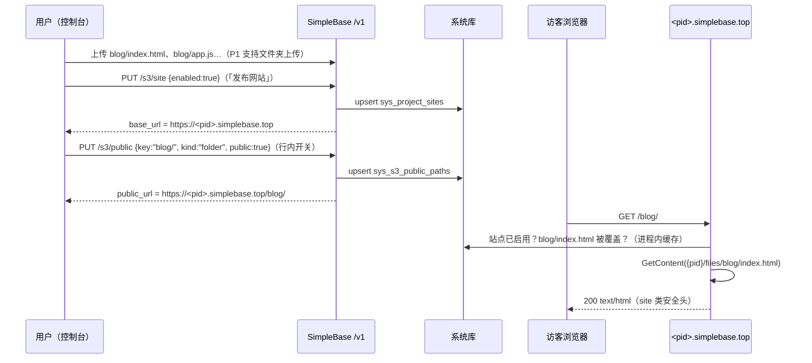

# 对象存储发布网站：项目泛域名 + 按路径外部访问（planv6.5）

> **状态：** P0 已实现（后端站点面 / 管理 API / 列表字段 / 前端发布区块与两列）；P1、P2 未做
> **日期：** 2026-11-10
> **关联代码：** `internal/api/s3_handler.go`、`internal/api/s3_content_handler.go`、`internal/api/router.go`、`internal/api/middleware_http.go`、`internal/systemdb/schema.go`、`internal/systemdb/s3index.go`、`internal/config/*`、`internal/web/web.go`、`ui/src/pages/S3Manager.vue`、`ui/src/services/{types,http-api}.ts`、`ui/src/locales/*`、`packages/js-sdk`

**Goal：** 对象存储页可以「发布网站」。发布后项目得到 `https://<项目ID>.simplebase.top`。存的是 HTML 时，浏览器直接打开 `https://<项目ID>.simplebase.top/<文件夹>/xxx` 就能预览。文件表格新增两列：**外部访问**开关、**访问 URL**。

**Architecture：** 两层开关：

1. 项目级「站点开关」决定泛域名是否生效。
2. 路径级「外部访问开关」决定具体文件或文件夹能否被匿名访问。

只有两层都打开时才可以访问；其余情况统一返回 404，不暴露对象是否存在。泛域名请求在 Echo 的 `Pre` 阶段按 Host 识别，然后改写到内部站点路由。这样它绕开鉴权、SPA fallback 和控制台 CSP，同时复用现有的 `ContentStore.GetContent` 流式读取、Range 和 ETag 逻辑。

---

## 0. 现状（代码事实）

| # | 事实 | 位置 | 对本需求的影响 |
| --- | --- | --- | --- |
| 1 | 文件物理布局是 `{projectID}/files/{userKey}`，`joinKey` 负责拼接；`ValidateFileKey` 拒绝 `..`、`.`、前导 `/`、`\`、NUL | `s3_handler.go`、`objectstore/filestore.go` | 站点路径直接复用。URL 解码后必须再走一次 `ValidateFileKey` |
| 2 | 下载只有两条路径：鉴权的 `/v1/projects/:pid/s3/objects/content`，以及 HMAC 私链 `/files/:token`（最长 24h） | `router.go:527-534` | 没有匿名、长期、可读的 URL，需要新增站点面 |
| 3 | `streamObject` 只对 png/jpeg/gif/webp/pdf/text/plain 设置 `inline`，`text/html` 和 svg 强制 `attachment` | `s3_content_handler.go:191-245` | 站点面需要另写一套 disposition 与 Content-Type 策略，**不能改动控制台源上的这份白名单** |
| 4 | 安全头按**路径**分类（file/api/console）。console 类型带 `script-src 'self'` 和 `X-Frame-Options: DENY`，file 类型带 `sandbox; default-src 'none'` | `middleware_http.go:40-110` | 站点 HTML 如果落在 file 类，脚本和样式会全部被 CSP 拦截。需要增加按 **Host** 判定的 `site` 类 |
| 5 | 所有未匹配的 GET 请求最终落到 SPA `index.html` | `web/web.go:69-101`，`router.go:334` | 泛域名请求必须在路由匹配前分流，否则会返回控制台页面 |
| 6 | 上传时会嗅探 MIME。S3 模式下落盘的 Content-Type 取**嗅探结果**，`.css`/`.js` 会被存成 `text/plain; charset=utf-8`；本地模式按扩展名返回 | `s3_content_handler.go:59-79`、`content_local.go:64` | 全局有 `nosniff`，CSS/JS 按 text/plain 返回会被浏览器拒绝执行。站点面**必须按扩展名重新推导 Content-Type** |
| 7 | 对象索引表 `sys_s3_objects` 只有 key/size/etag/content_type，没有公开属性 | `systemdb/schema.go:184` | 公开状态需要新建表，不要在索引表上补列（DuckLake 不支持带 NOT NULL 的 ADD COLUMN，`internal/AGENTS.md` 也禁止 ALTER） |
| 8 | 项目 ID 固定 8 位 `[A-Za-z0-9-]`，`NewProjectID` 只生成小写，但用户可以指定 ID；系统项目是 `sb-admin` | `godatabase/blob/keys.go:147-178`、`catalog/reserved.go:50` | DNS 不区分大小写，标签也不能以 `-` 开头或结尾。含大写字母或首尾为 `-` 的 ID、以及 `sb-admin`，都不允许发布 |
| 9 | 控制台凭据存在 `localStorage`（Bearer），不用 Cookie | `ui/tests/http.test.ts` | 子域站点里的 JS 读不到控制台令牌。前提是今后控制台不下发 `Domain=.simplebase.top` 的 Cookie |
| 10 | 控制台单文件上传最大 50MiB，只能逐个选文件，不能上传文件夹 | `S3Manager.vue:156-214` | 发布一个站点通常要传整个目录，需要支持文件夹上传（P1） |
| 11 | 列表接口带 `delimiter` 时返回 `{folders: string[], objects: [...]}`；`gocloudagent_access.go` 复用 `ListObjects` | `s3_content_handler.go:91-111` | 返回结构只能**增加字段**，`folders` 保持 `string[]` 不变 |

---

## 1. 全局约束

- 默认关闭：`sites.enabled=false` 时不注册任何站点路由，Pre 分流也不生效，行为与现在完全一致。
- 公开是显式动作：上传时不自动公开；路径开关默认关闭；关闭站点开关后，所有路径立刻不可访问，但路径级开关保留。
- 统一返回 404：站点未启用、路径未公开、对象不存在、key 不合法，都返回同一个 404 页面，响应体里不带 request_id 以外的诊断信息。
- 只读服务：站点面只接受 `GET`/`HEAD`，其余方法返回 405。站点面不写系统库（只读实例上也能提供访问）。
- 写路径（开关站点、开关路径）全部挂 `writeGate`，并检查 `writable`；系统项目 `sb-admin` 一律拒绝。
- 不新增第三方依赖，不改 `go.mod`/`package.json`；配置只走 `config.yaml` + `SIMPLEBASE_SITES_*`。
- 不改 S3 key 布局（金标 `keys.golden` 不动）。
- 控制台源上的 `/s3/objects/content` 和 `/files/:token` 仍然保持 HTML 走 `attachment`。HTML 只能在**站点子域**上渲染。

---

## 2. 用户旅程



---

## 3. 数据模型（`internal/systemdb/schema.go`）

新增两张表，直接写进 `systemTables`（使用 `CREATE TABLE IF NOT EXISTS`，已有的库启动时会自动建表，不需要 reset）：

```sql
-- 项目级站点开关（一个项目最多一行，唯一性由应用层保证）
CREATE TABLE IF NOT EXISTS sys_project_sites (
  project_id   VARCHAR NOT NULL,
  enabled      BIGINT  NOT NULL DEFAULT 0,
  spa_fallback BIGINT  NOT NULL DEFAULT 0,   -- P2：未命中时回退到 index.html
  created_by   VARCHAR NOT NULL DEFAULT '',
  created_at   TIMESTAMP NOT NULL,
  updated_at   TIMESTAMP NOT NULL
);

-- 路径级外部访问开关
CREATE TABLE IF NOT EXISTS sys_s3_public_paths (
  id          VARCHAR NOT NULL,
  project_id  VARCHAR NOT NULL,
  path        VARCHAR NOT NULL,              -- 文件：完整 key；文件夹：以 "/" 结尾的前缀；"" = 整个存储桶
  kind        VARCHAR NOT NULL,              -- file | folder
  created_by  VARCHAR NOT NULL DEFAULT '',   -- actor，例如 user:<id> / key:<id>
  created_at  TIMESTAMP NOT NULL
);
```

新增 `internal/systemdb/sites.go`：

- `GetProjectSite(ctx, pid) (ProjectSite, error)` / `SetProjectSite(ctx, pid, enabled, actor)`
- `ListPublicPaths(ctx, pid) ([]PublicPath, error)` / `SetPublicPath(ctx, pid, path, kind, public, actor)`（public=false 时删除该行）
- `DeletePublicPathsUnder(ctx, pid, prefix)`：删除对象或删除项目时清理
- `IsPublic(paths []PublicPath, key string) (matched PublicPath, ok bool)`：纯函数，规则是「file 精确匹配，或者任一 folder 前缀覆盖」，取最长前缀，用于判断开关是否为继承状态

需要同步修改的测试：`SystemTableCount` 相关断言和 `schema_status` 的快照（如有）；`sites_test.go` 覆盖增删改查与 `IsPublic` 的前缀边界（`blog/` 不能覆盖 `blog2/x`）。

> 不在 `sys_s3_objects` 上加 `public` 列：一是公开文件夹会覆盖尚未上传的对象；二是 refresh 对账（`RefreshS3Index`）会重建索引行，从而冲掉公开状态。

---

## 4. 配置（`internal/config`）

`config.example.yaml` 新增一段（`yaml.go` / `config.go` / `env.go` / `profile.go` 同步）：

```yaml
# ── Sites（对象存储发布网站，planv6.5）──────────────────
sites:
  enabled: false              # SIMPLEBASE_SITES_ENABLED
  base_domain: ""             # 例：simplebase.top → <pid>.simplebase.top；SIMPLEBASE_SITES_BASE_DOMAIN
  url_scheme: https           # 生成访问 URL 用；SIMPLEBASE_SITES_URL_SCHEME
  url_port: 0                 # 非 0 时拼进 URL（本地开发：base_domain=localhost, url_scheme=http, url_port=8080）
  index_document: index.html  # 目录默认文档
  not_found_document: ""      # 例 404.html；需要同样处于公开路径下
  cache_ttl: 30s              # 站点 / 公开路径的进程内缓存 TTL（只读副本靠它收敛）
```

校验（`config.Validate`）：

- `enabled=true` 时 `base_domain` 必填，且不能包含 `*`、`/` 或端口。
- `http.public_url` 的 host 等于 `base_domain` 或位于其下时，production profile **给出告警**（见 §9 同站风险）。
- 本地开发：浏览器会把 `*.localhost` 解析到 127.0.0.1，`http://<pid>.localhost:8080/` 不用改 hosts 就能直接用。

---

## 5. 后端改造

### 5.1 Host 分流（新增 `internal/api/site_dispatch.go`）

- 在 `NewRouter` 中，`sites.enabled` 为真时注册 `e.Pre(siteHostMiddleware(cfg))`：
  1. 取 `c.Request().Host`，去掉端口并转小写。只信任 `Host`，**不读 `X-Forwarded-Host`**（反向代理要保留原始 Host）。
  2. 匹配 `^<label>\.<base_domain>$`，其中 label 必须正好 8 位 `[a-z0-9-]`，且首尾不能是 `-`。
  3. 匹配成功：`c.Set(ctxSiteProject, label)`，把 `URL.Path` 改写成 `/__site` + 原路径（保留 `RawPath`，避免二次解码）。
  4. 匹配失败或者不是站点 Host：直接放行，控制台行为不变。
- 注册 `e.Match([]string{GET, HEAD}, "/__site/*", siteHandler.Serve)`，不挂任何鉴权中间件。handler 首先检查 `ctxSiteProject`，**没有就返回 404**，防止有人在控制台域直接请求 `/__site/...`。
- `e.Pre` 在 `e.Use` 之前执行，改写完成后 requestID、accessLog、Recover、pre_auth 限流、BodyLimit 照常生效。

### 5.2 站点 handler（新增 `internal/api/site_handler.go`）

`SiteHandler{store objectstore.FileStore, sites siteLookup, cfg config.SitesConfig}`，其中 `siteLookup` 是接口，由 adapter 包一层 `systemdb.Store` 并加上 TTL 缓存。

`Serve` 的处理顺序：

1. `pid := ctxSiteProject`；`pid == catalog.ReservedSystemProjectID` 时返回 404。
2. `site, err := sites.Get(pid)`：未启用返回 404。
3. 路径归一化：去掉 `/__site` 前缀和前导 `/`。路径为空或以 `/` 结尾时，拼上 `index_document`；用**解码后**的路径跑 `ValidateFileKey`，失败返回 404（覆盖 `%2e%2e`、`%5c`、`%00` 等变体）。
4. 公开判定：`IsPublic(paths, key)`，未覆盖返回 404。
5. 读取对象：`ContentStore.GetContent(joinKey(pid,key), Range)`；`ErrNotFound` 时进入第 6 步。
6. 目录补斜杠：最后一段不带扩展名，且 `key + "/" + index_document` 存在并且公开时，返回 **301** 到 `/<path>/`（保留 query）。否则如果配置了 `not_found_document`，并且它公开、存在，就以 404 状态码返回该文件；都不满足时返回内置的极简 404。
7. 响应头：
   - `Content-Type` 按 `mime.TypeByExtension(ext)` 设置，查不到时回退到存储里的类型（解决 §0 #6）。`text/*`、`application/javascript` 补上 `charset=utf-8`。
   - **不设置** `Content-Disposition`，浏览器默认 inline 渲染。
   - `Cache-Control`：`.html` 用 `no-cache`，其他资源用 `public, max-age=300`。沿用 ETag / 304 / Range / `Accept-Ranges`。
   - `HEAD` 只返回头。
8. 可以从 `streamObject` 中抽出 `writeContent(c, content, opts)` 公共函数，供两处复用。抽取时**不能改变** `streamObject` 现有的 disposition 行为（已有的 `s3_content_handler_test.go` 要继续通过）。

### 5.3 安全头（`middleware_http.go`）

- `routeClass` 改为接收 `echo.Context`：`ctxSiteProject` 存在时返回 `"site"`（优先级最高），其余逻辑保持不变。
- 新增 `siteCSP`：用户站点需要执行自己的脚本，所以不能套用 console/file 策略。建议默认值：
  `default-src 'self' https: data: blob: 'unsafe-inline' 'unsafe-eval'; frame-ancestors 'self'; base-uri 'self'; form-action 'self' https:`
  并支持 `sites.csp` 配置覆盖（空表示使用默认，`off` 表示不发送）。
- site 类：`X-Frame-Options: SAMEORIGIN`（替换掉全局 DENY），不发 COOP 和 CORP，保留 `nosniff`、`Referrer-Policy: no-referrer`。HSTS 沿用现有判定。
- 同时修改 `production_entry_test.go` 中的 `TestSecurityHeadersByRouteClass`，加入 site 用例。

### 5.4 管理 API（`s3_handler.go` 扩展或新增 `s3_site_handler.go`）

| 方法 | 路径 | 权限 | 说明 |
| --- | --- | --- | --- |
| GET | `/v1/projects/:pid/s3/site` | `database:read` | `{enabled, base_url, publishable, reason?}`。`publishable=false` 时给出原因：ID 含大写、首尾为 `-`、系统项目、`sites.enabled=false` |
| PUT | `/v1/projects/:pid/s3/site` | `database:admin` + `writeGate` | `{enabled}`，即「发布网站 / 下线网站」 |
| GET | `/v1/projects/:pid/s3/public` | `database:read` | 返回公开路径列表 |
| PUT | `/v1/projects/:pid/s3/public` | `database:admin` + `writeGate` | `{key, kind: file\|folder, public: bool}`。folder 的 key 必须以 `/` 结尾，`""` 表示整个存储桶；用 `ValidateFileKey` 校验（`""` 除外）；返回 `{public, public_url}` |

- 权限：公开等于对外暴露数据，所以用 `database:admin`，并且 **P0 不做 `delegable`**，云助手的委托令牌不能替用户开启公开。判定统一走 `auth.Require`。
- 系统项目：`IsSystemProject` 前置拒绝，新增哨兵 `ErrSiteNotPublishable → 400 invalid_request`，加到 `error.go` 的 `sentinelErrorMappings`。
- `sites.enabled=false` 时，这组路由**照常挂载**，GET 返回 `publishable=false`，PUT 返回 `ErrSiteNotPublishable`，方便前端统一展示。
- 审计：`site.enable` / `site.disable` / `s3.public.set` / `s3.public.unset` 写入 `sys_audit_events`，只记录 pid、kind 和 path 的 SHA-256 前缀，不记录完整 key。
- 写成功后调用 `sites.Invalidate(pid)`，让本进程缓存立即失效；只读副本依靠 `cache_ttl` 收敛。

### 5.5 列表接口增量字段（`ListObjects` / `s3ListResponse`）

只追加字段，不修改现有字段：

```jsonc
{
  "folders": ["blog/"],                       // 不变
  "objects": [{ "key": "a.html", "size": 1, "lastModified": "...",
                "public": true, "publicUrl": "https://<pid>.simplebase.top/a.html",
                "publicInherited": "blog/" }], // 新增；继承时给出覆盖它的文件夹
  "folderMeta": [{ "key": "blog/", "public": true, "publicUrl": "https://<pid>.simplebase.top/blog/", "publicInherited": "" }],
  "site": { "enabled": true, "baseUrl": "https://<pid>.simplebase.top", "publishable": true }
}
```

- 不带 `delimiter` 的数组形态也给每个对象加上 `public`/`publicUrl`。
- 字段命名沿用 S3 域现有的 camelCase 例外（`lastModified`）。
- `publicUrl` 只在**站点启用并且路径公开**时返回；URL 按路径段分别做 `url.PathEscape`，空格、中文、`#`、`?` 都要编码。
- 公开路径列表每次请求只查一次，按项目缓存，复杂度为 O(n·m)，m 很小。
- 回归验证：`gocloudagent_access.go` 对列表结果的解析不受影响（加一条断言）。

### 5.6 生命周期联动

- `DeleteObject`：删除 `kind=file && path=key` 的公开行。文件夹行不处理，因为文件夹可能还有其他对象，或者之后会重新上传。
- 删除项目或清理项目文件（`ProjectFilePurger` 及项目删除路径）：调用 `DeletePublicPathsUnder(pid, "")` 并删掉 `sys_project_sites` 行。
- 删库（`ProjectDataClearer`）**不**影响站点（文件本来就保留）。

### 5.7 装配（`internal/app`）

- `Dependencies` 增加 `Sites SiteLookup`（接口）。`assembleDeps` 在 `System` 与 `S3FileStore` 都可用时创建，否则为 nil，不注册站点路由。
- `S3FileStore` 必须实现 `ContentStore`，不实现时站点路由不挂载并打 warn。

---

## 6. 前端改造（`ui/`）

### 6.1 类型与 API 层

- `services/types.ts`：
  - `S3Object` 增加 `public?: boolean`、`publicUrl?: string`、`publicInherited?: string`
  - 新增 `S3FolderMeta`、`S3SiteInfo`，并给 `S3ListResult` 增加 `folderMeta`、`site`
  - 全部用 `interface` 定义
- `services/http-api.ts` 的 `s3` 增加：`getSite`、`setSite(enabled)`、`setPublic(key, kind, public)`。`listDetailed` 映射新字段，不新增 `any`。

### 6.2 `pages/S3Manager.vue`

- **卡片头**：新增「发布网站」区块。
  - 未发布：显示「发布网站」按钮。通过 `ConfirmAction` 二次确认，文案说明「仅开启了外部访问的路径可被匿名访问」。
  - 已发布：显示站点 URL（可复制，点击新窗口打开）和「下线」按钮。
  - `publishable=false`：按钮禁用，用 tooltip 说明原因。
- **表格**：从 4 列改为 6 列。`SbAsyncRegion :columns="6"`，文件夹行的 `colspan` 同步调整。
  - 「外部访问」列：使用真实的 `Switch`（`modelValue` / `update:modelValue`）。
    - 站点未发布时禁用，tooltip 提示「请先发布网站」。
    - 继承状态（`publicInherited` 非空）：开关显示打开但禁用，提示「继承自 `blog/`」。
    - 文件夹行操作 `kind=folder`，文件行操作 `kind=file`。切换时做乐观更新，失败回滚并 `toast.error`。
  - 「访问 URL」列：有 `publicUrl` 时显示截断的链接、复制按钮和新窗口打开按钮；没有时显示 `—`。
- 预览弹窗 `S3PreviewModal`：`.html` 文件在已公开时增加「在站点中打开」，控制台源上仍然不内联渲染 HTML。
- 权限体验：非 admin 角色的开关只读（后端才是真正的保护）；admin 项目（`isAdmin`）隐藏整个发布区块。

### 6.3 文案与测试

- `locales/zh-CN.ts` 与 `en-US.ts` 在 `pages.s3` 下同时补齐以下 key：`site.*`（publish、unpublish、url、confirm、notPublishable.*）、`colPublic`、`colPublicUrl`、`inheritedFrom`、`publicOn/Off`、`publicFailed`、`sitePublished` 等。注意不要出现裸 `@`。
- `ui/tests`：S3Manager 增加用例，覆盖发布与下线、开关切换成功和失败回滚、继承禁用、未发布时禁用、URL 复制。**不对 Switch 打桩**，断言 `data-state`。保持 coverage 阈值，新增函数要全部覆盖。

### 6.4 文件夹上传（P1）

- 增加「上传文件夹」按钮（`<input webkitdirectory multiple>`），用 `webkitRelativePath` 作为 key，并支持填写目标前缀。
- 逐个上传，每个文件仍走 50MiB 上限和 `validateKey`；并发 3；汇总进度；失败的文件列出清单，允许重试。
- 上传 `.js`/`.css`/`.svg`/`.wasm` 时，确认现有 MIME 嗅探规则不会误报 415：`.svg` 声明为 `image/svg+xml`，嗅探结果是 `text/xml`；`.wasm` 嗅探结果是 `application/wasm`。为这几类补充 `sniffUploadMIME` 用例，必要时扩充 `plainTextSubtypes` 或增加站点资源白名单。注意 `allowed_mime` 非空时可能挡住 html/js，需要在文档里说明。

---

## 7. SDK / CLI / 文档

- `packages/js-sdk`：`s3.site.get/set`、`s3.setPublic`，补类型和测试（P1）。
- `internal/sbcli`：`file site enable|disable|status`、`file public <key> [--folder] --on|--off`（P2）。两端语义规则（AGENTS.md 硬性约束 10）不涉及这部分。
- `docs/`：
  - `docs/data/` 下的对象存储文档增加「发布网站」章节。
  - `docs/ops/` 增加部署说明：
    - 泛解析 `*.simplebase.top → 入口 IP`
    - 泛域名证书（DNS-01，`*.simplebase.top`）
    - 反向代理必须透传 `Host`
    - 把代理地址写入 `trusted_proxies`，HSTS 才能正确判定
    - 本地开发使用 `<pid>.localhost:8080`

---

## 8. 测试清单

**后端（`go test ./internal/...`）**

- `site_dispatch_test.go`
  - Host 解析：带端口、大写 Host、非 8 位 label、首尾为 `-`、多级子域 `a.b.simplebase.top`、只有裸 `simplebase.top`
  - 未匹配的请求仍然由 SPA 和 API 正常处理
  - 控制台域直接请求 `/__site/x` 返回 404
- `site_handler_test.go`（fake `ContentStore` + fake `siteLookup`）
  - 站点未启用返回 404
  - 路径未公开返回 404
  - 文件精确公开、文件夹前缀公开、前缀边界（`blog/` 不能覆盖 `blog2/`）、根路径 `""` 全公开
  - `/` 和 `/dir/` 回退到 `index.html`；`/dir` 返回 301
  - `not_found_document`
  - 路径穿越：`%2e%2e`、`..%2f`、`%5c`、`%00`
  - Content-Type 按扩展名推导（S3 存成 text/plain 的 css 要返回 text/css）
  - Range / ETag / 304 / HEAD；POST 返回 405
  - `sb-admin` 返回 404
- `s3_site_handler_test.go`
  - 权限：read 只能 GET；write 不能 PUT；必须 admin
  - **`writable=false` 返回 503**
  - **系统项目拒绝**
  - 含大写的 ID 不可发布
  - `sites.enabled=false` 时的返回
  - 审计事件不含明文 key
  - 写后缓存失效
- `s3_handler_test.go`：列表新增字段，`publicUrl` 编码正确；未发布时不返回 `publicUrl`；`DeleteObject` 联动清理 file 行。
- `production_entry_test.go`：site 类安全头。
- `systemdb/sites_test.go`、schema 表数量断言。
- `config`：YAML、env、Validate 与 production 告警。

**前端**：`yarn test`（≥95%）、`yarn build`。

**端到端（手工 / smoke）**

1. `sites.enabled=true base_domain=localhost url_scheme=http url_port=18087` 启动服务。
2. 上传 `demo/index.html` 和 `demo/app.js`，发布网站，打开 `demo/` 的外部访问开关。
3. `curl -H 'Host: <pid>.localhost' http://127.0.0.1:18087/demo/` 返回 200 text/html；访问 `demo/app.js` 返回 `text/javascript`。
4. 关闭站点开关后访问返回 404。
5. 用浏览器打开 `http://<pid>.localhost:18087/demo/`，确认脚本能执行。

---

## 9. 风险与决策

| 风险 | 说明 | 处理 |
| --- | --- | --- |
| 同站风险 | 控制台如果也部署在 `simplebase.top` 或其子域，用户站点与控制台就是 same-site：站点 JS 可以向控制台源发请求；今后如果引入 `Domain=.simplebase.top` 的 Cookie，会被所有站点共享 | **建议控制台用独立域名**（或者把 `simplebase.top` 申请进 Public Suffix List，像 github.io、pages.dev 那样）。当前凭据在 localStorage 并且走 Bearer，所以风险可控。production 配置校验给出告警，并在 AGENTS.md 增加约束：「禁止下发父域 Cookie」 |
| 钓鱼 / 滥用 | 匿名可访问的 HTML 可能被用来托管钓鱼页 | 发布需要 admin 权限，并写审计；P2 增加站点级流量和请求数配额（`usage` 记 `site_egress`），并提供管理员下线入口 |
| 带宽 | 大文件匿名下载会消耗出口带宽 | 复用 pre_auth 的 IP 限流；P2 加按项目限流和出口用量统计 |
| 缓存一致性 | 只读副本或多进程的缓存不会立即失效 | 本进程写后主动失效，其余副本最多延迟 `cache_ttl`（默认 30s），在文档中说明 |
| 项目 ID 大小写 | 历史上指定的含大写 ID 无法映射到 DNS | 不可发布并说明原因；不做大小写模糊匹配，避免两个项目抢同一个子域 |
| HTML 在控制台源执行 | 如果误把站点策略用在 `/s3/objects/content` 上，会形成控制台源上的存储型 XSS | 站点策略只按 `ctxSiteProject` 生效；控制台源的 inline 白名单保持不变，并有测试锁定 |

---

## 10. 分期

| 阶段 | 内容 | 验收 |
| --- | --- | --- |
| **P0** | §3 数据表；§4 配置；§5.1–5.7 后端（分流、站点 handler、安全头、管理 API、列表字段、生命周期）；§6.1–6.3 前端（发布区块 + 两列）；§8 测试 | 本地 `<pid>.localhost` 端到端跑通；`go test ./...`、`yarn test`、`yarn build` 全部通过 |
| **P1** | §6.4 文件夹上传与 MIME 用例；js-sdk；`docs/ops` 泛域名部署文档；预览弹窗增加「在站点中打开」 | 一次上传一个静态站点目录并直接访问 |
| **P2** | `spa_fallback`；sbcli 命令；站点配额与出口统计；管理员全局下线；自定义域名（CNAME + 证书，需单独立项） | — |

---

## 11. 改动文件清单（P0）

| 文件 | 改动 |
| --- | --- |
| `internal/systemdb/schema.go` | 新增两张表 |
| `internal/systemdb/sites.go`（新） + `sites_test.go` | 站点 / 公开路径仓库、`IsPublic` |
| `internal/config/{config,yaml,env,profile}.go`、`config.example.yaml` | `sites` 配置段、校验与告警 |
| `internal/api/site_dispatch.go`（新） | Pre 阶段按 Host 分流 |
| `internal/api/site_handler.go`（新） | 匿名站点读取 |
| `internal/api/s3_site_handler.go`（新） | 站点与公开路径管理 API |
| `internal/api/s3_handler.go`、`s3_content_handler.go` | 列表增量字段、删除联动、抽取 `writeContent` |
| `internal/api/middleware_http.go` | `site` 路由类别与 `siteCSP` |
| `internal/api/router.go` | `Dependencies.Sites`、路由注册、`e.Pre` |
| `internal/api/error.go` | `ErrSiteNotPublishable` 映射 |
| `internal/api/adapter.go` | `siteLookup` 缓存适配 |
| `internal/app/*` | 装配 `Sites` |
| `ui/src/services/{types,http-api}.ts` | 类型与 API |
| `ui/src/pages/S3Manager.vue`、`components/modal/S3PreviewModal.vue` | 发布区块、两列 |
| `ui/src/locales/{zh-CN,en-US}.ts` | 文案 |
| `ui/tests/*` | 页面测试 |
| `AGENTS.md`（根） | 「设计计划文档」段落补上 planv6.5；硬性约束增加「站点子域与控制台禁止共享父域 Cookie」 |
